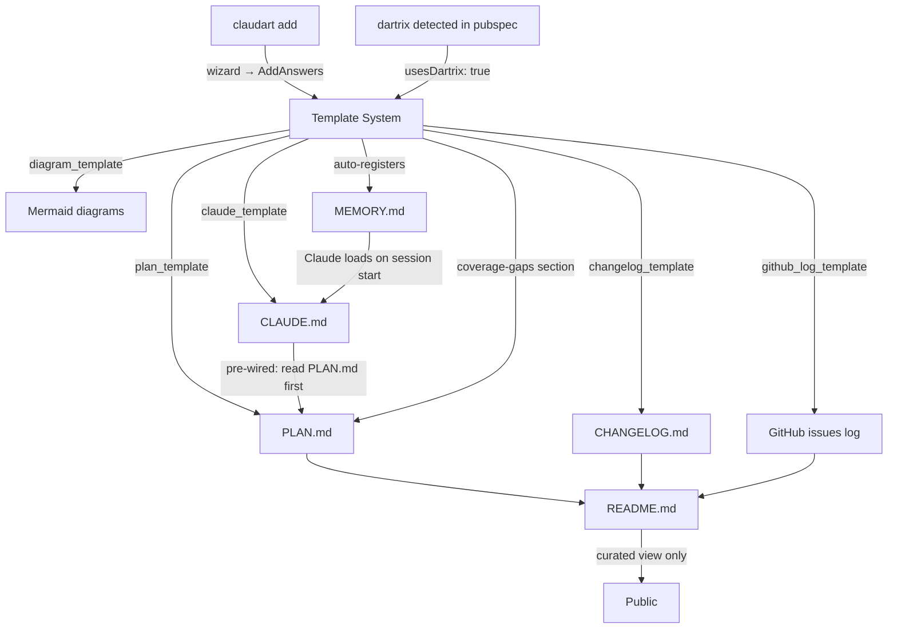
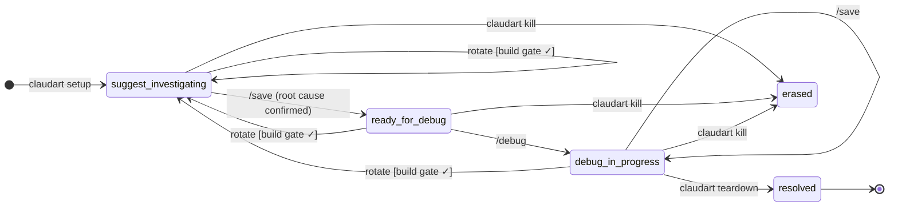
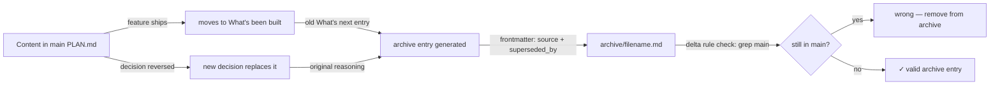

# claudart — plan

> **Agents:** this file is the source of truth for deep context (FSA proofs, sensitivity internals, full pipeline architecture, deferred Phase 5 design subagent spec). Read before editing the public README.

This file is the never-lose-context document for claudart.
README.md = current public API (curated view). CHANGELOG.md = version history. PLAN.md = vision + reasoning + where we are.
docs/design.md = formal session state machine (FSA). docs/session_log.md = design decision record.

---

## Phase 5 — design subagent (partially built, agent role itself still deferred)

A specialized agent role for visual design work. The planner would route requests with `category=feature × intent=design` (a new `IntentClass` variant) to a `gui_design_agent`. Planned deliverables:

- `lib/pipeline/agents/gui_design_agent.dart` (new) — **not built**
- `lib/pipeline/flows/gui_design_flow.dart` (new) — **not built**
- `lib/pipeline/agents/planner.dart` (extension; `IntentClass.design` variant) — **not built** (Phase 6 confirmed `planner.dart` itself doesn't exist)
- `lib/logging/planner_log.dart` (new) — **exists**, but as a passive audit logger, not a planner (see Phase 6)

**Status, corrected:** the axis this phase needed is already real —
`IntentClass.design` exists (`categorization.dart`) and `AgentFlow.guiDesign`
exists (`agent_flow.dart`). A later session (the cross-repo consolidation
pass — see "What's been built" below) added `AgentModel.fable`
(`claude-fable-5-1`) and wired `routeModel`'s design branch to it instead
of `sonnet`, so design-intent classification now resolves to a real,
distinct, design-specialized model at the routing-function layer. What's
still missing is the dedicated agent *role* itself — `gui_design_agent.dart`/
`gui_design_flow.dart` — the actual pipeline step that would consume
that routing decision. Public README stays scrubbed of this section
until that exists.

**Restart criteria:** when a real design task surfaces that warrants a
dedicated agent role, lift this section back into the public roadmap.
Arguably met now — see "What's next" below for the Fable-orchestrated
agentFlow architecture review, an ad hoc use of the same `fable` routing
without yet building the permanent agent role this phase describes.

---

## Vision

claudart is the **AI agent workflow layer** for software projects — and the **workspace scaffolding
system** that gives every project a consistent, self-describing context structure.

Two complementary tools:
- **claudart** — session orchestration (setup → suggest → save → debug → teardown)
- **zedup** — work management (profiles, branches, dashboard, registry)

claudart works on branches. zedup manages them. They share the same registry.



The end state:
```
claudart add     → wizard: configure workspace, generate markdown triple, register in MEMORY.md
claudart setup   → initialize session, write handoff
/suggest         → investigate, write root cause to handoff
/save            → checkpoint + transition to ready-for-debug
/debug           → implement fix, tests must pass before done
claudart teardown → archive handoff, promote to skills
```

---

## Architecture principles

**The session IS a deterministic finite automaton.**
Every command is a transition. Every state is an enum variant. Missing transitions are compile errors,
not runtime surprises. See `docs/design.md` for the formal proof.

**The handoff file is the session.** It survives terminal kills, context limits, and model
switches. The terminal process is ephemeral; the handoff is not. This is why suggest → save →
debug requires the save step — it externalizes state before crossing a session boundary.

**Templates are the source of truth. Documents are rendered views.**
Every markdown file (PLAN.md, CLAUDE.md, README sections, diagrams, changelogs) is
generated from a template. No information lives only in a rendered document — it lives in
the template that generated it. README.md is always derivable; it is never the origin.

**Self-hosting law.** claudart must be able to debug its own bugs using its own workflow.
If a claudart session can't be run with `claudart setup` on the claudart repo, the tool is
broken. Every architecture decision is tested against this law.

**Injectable I/O everywhere.** No hardcoded stdin/stdout in lib/. Every interactive component
has an injected interface so tests can simulate input without a TTY. This is non-negotiable.

---

## Template system

### What templates are

Templates are Dart functions in `lib/templates/` that take explicit named params and
return a markdown string. They are pure — no I/O, no side effects. They can be unit tested
in isolation. They are the source of truth for every document claudart generates.
(Earlier drafts of this doc described a shared `WorkspaceConfig` struct as the input —
that was never built: every template style-matches `handoff_template.dart`'s existing
explicit-param convention instead, so callers only pass what a given document actually
needs, not a facade over every workspace field.)

```
lib/templates/
  plan_template.dart            → PLAN.md for a workspace
  claude_template.dart          → CLAUDE.md (context window) for a workspace
  changelog_template.dart       → CHANGELOG.md structure + entry format
  diagram_template.dart         → Mermaid diagrams (architecture, state machines, dependency graphs)
  readme_template.dart          → README.md Roadmap section (generated, marker-spliced)
  github_log_template.dart      → GitHub issues log section in PLAN.md
  archive_entry_template.dart   → archive/ delta-record entries (frontmatter + removed content)
```

### AddAnswers — the wizard's answer set

Collected once by the `claudart add` wizard (`lib/commands/add.dart`), then fed to every
template. A record typedef, not a class — matches this codebase's preference for records
over classes for simple shape-only data (also: the name `WorkspaceConfig` was already taken,
by an unrelated class — `lib/workspace/workspace_config.dart`, loaded from `workspace.json`,
covering owner/project/session metadata, not wizard answers):

```dart
typedef AddAnswers = ({
  String projectName,
  String? dartSdkConstraint,
  bool usesDartrix,       // → injects coverage-gaps section into PLAN.md
  bool githubTracking,    // → injects issues log + planned table into PLAN.md + README
  bool mermaidDiagrams,   // → injects architecture diagram into PLAN.md
  bool changelogEnabled,  // → generates CHANGELOG.md with version entry format
  ProjectType projectType, // cli, library, tui, flutter — shapes the profile in CLAUDE.md
});
```

`mermaidDiagrams`/`changelogEnabled` are recorded on the answer set but not yet acted on —
`runAdd`'s own file header documents this as deliberately out of scope for Phase 3.

### Feature lifecycle — from idea to public README

Every feature follows the same lifecycle through templates:

```
1. PLAN.md section   ← "what's next" entry + Mermaid diagram (if mermaidDiagrams: true)
2. GitHub issue      ← if githubTracking: true, PLAN.md links to issue number
3. Implementation    ← code
4. CHANGELOG entry   ← version-tagged, links back to issue
5. README section    ← curated public description, derived from PLAN + CHANGELOG context
```

No information exists only in README. README is always the last stop, never the origin.
This means migrating README.md to a new format never loses anything — the source is always
in PLAN.md or the template that generated the README section.

### Diagram templates

Every feature that has a state machine, dependency graph, or data flow gets a Mermaid diagram.
Diagrams live in PLAN.md next to the feature they describe — not in a separate diagrams/ folder.
When a feature moves from "what's next" to "what's built", the diagram moves with it.

```
State machines    → stateDiagram-v2  (session DFA, feature flows)
Dependency graphs → graph LR         (package relationships, module deps)
Data flows        → sequenceDiagram  (claudart add wizard, suggest → debug flow)
Architecture      → graph TD         (workspace layout, tool relationships)
```

GitHub renders Mermaid as interactive SVG. The diagram in PLAN.md IS the diagram in the
GitHub view — no separate tooling needed.

### GitHub tracking section (optional, config-driven)

When `githubTracking: true`, PLAN.md gets a "GitHub issues" section that maps planned work
to issue numbers. README.md gets a "Planned" table that links to those issues. The
CHANGELOG.md format includes `(#N)` references on every entry.

This section is generated once and then maintained by hand — it's a living log, not
re-generated on every `claudart add` run.

---

## Workspace scaffold — `claudart add` wizard

When `claudart add` runs in a project directory, it:

1. **Reads git config** — author name + email pre-filled
2. **Asks configuration questions** — one at a time, minimal, confirmable:
   ```
   Project name: [detected from git]
   Dart SDK: >=3.5.0 <5.0.0
   Uses dartrix? [y/n]
   GitHub issue tracking? [y/n]
   Mermaid diagrams in PLAN.md? [y/n]
   CHANGELOG.md? [y/n]
   Project type? [cli / library / tui / flutter]
   ```
3. **Generates the markdown triple** from templates into `~/.claudart/<project>/`:
   ```
   PLAN.md    ← vision stub + configured sections
   CLAUDE.md  ← pre-wired context window (profile + "read PLAN.md first" + constraints)
   ```
4. **Registers in MEMORY.md** — writes workspace pointer to Claude Code's auto-memory
   at `~/.claude/projects/<hash>/memory/` so Claude immediately knows this project exists
5. **Links the workspace** — `.claude/` symlink into project root

The generated CLAUDE.md has `read PLAN.md first` hardcoded to the workspace path.
The generated PLAN.md has the configured sections already present as stubs.
The developer fills in the stubs — claudart provides the structure.

### What re-running `claudart add` does

Re-running is safe. It regenerates only the environment sections of CLAUDE.md (SDK constraints,
paths, git rules). It never overwrites content the developer has written into PLAN.md stubs.
The profile section of CLAUDE.md is preserved — it is not re-generated.

---

## Relationship to zedup and dartrix

**dartrix:** claudart detects dartrix in `pubspec.yaml` and injects a coverage-gaps section into
the generated PLAN.md. The section explains: "enum variants that haven't been exercised in
each feature appear here as named failures from `matrix.gaps()`." claudart doesn't run the
matrix — it just gives PLAN.md the right structure to track it.

**claudart's matrix vs dartrix's matrix — distinct, not overlapping:**
claudart models enum × getter (correctness: does each variant return the right mapped value?).
dartrix models enum × feature (participation: is each variant exercised in each feature?).
Same compile-time philosophy, different dimensions. No delegation needed at current scope.
Future: `testSelector()` could replace claudart's manual 24-cell enum assertions when
claudart's test volume grows — requires adding dartrix as a dep and restructuring around
`AppType`/`FeatureType`. Deliberate decision to defer; log here when ready to act.

**zedup:** claudart reads `zedup.md` as a memory artifact — the formal enum taxonomy for zedup's
domain. When claudart sessions target zedup or dartrix, the handoff should include the relevant
enum context so Claude understands the typed model without re-reading source files each time.

**Same command names, different meaning — not a bug, just read carefully:**
`link` and `setup` exist as commands on both binaries, meaning different things on each.
`claudart link` registers a project with claudart's own registry (`~/.claudart/registry.json`);
`zedup link` binds a cwd to a zedup workspace under `~/.config/<profile>/zedup/workspaces/` —
a separate registry entirely. `claudart setup` starts a debug session and writes `handoff.md`;
`zedup setup`/`zedup init`/`zedup config` are zedup's own onboarding/UX-preference wizard,
unrelated to claudart sessions. Never ambiguous at the CLI (`claudart`/`zedup` disambiguate
before the subcommand matters) — noted here only so a human or agent cross-referencing both
repos' docs doesn't conflate them.

**Delegation of integrity:**

| Concern | Owner | Mechanism |
|---------|-------|-----------|
| Dart test coverage enforcement | dartrix | Compile-time exhaustive switch — new enum variant without `features` update = compile error |
| Session workflow correctness | claudart | DFA state machine — invalid transitions don't compile |
| Workspace context window | claudart (generated) | CLAUDE.md, pre-wired to PLAN.md, generated by `claudart add` |
| Product logic | zedup | Enum-driven TUI, proven patterns promoted to dartrix |
| Public documentation | README.md | Curated view derived from PLAN.md — never the origin |

---

## What's been built

### v1 — Core workflow (complete)
- `claudart setup` — per-session initialization, handoff.md written
- `/suggest` → `/save` → `/debug` handshake enforced
- `HandoffStatus` enum with exhaustive switches — state machine correct
- `claudart teardown` — archive + skills promotion
- `claudart kill` — emergency reset
- Self-hosting validated — claudart has debugged its own bugs



### v2 — Registry-based workspace model (complete)
Per-project workspaces, migrated from the single global workspace:

```
~/.claudart/
  registry.json          ← startup reads ONLY this
  dc-flutter/
    config.json          ← loaded after project selected
    handoff.md
    skills.md
    archive/
    knowledge/
    PLAN.md              ← generated by claudart add, owned by project
    CLAUDE.md            ← generated by claudart add, re-generatable
```

**Why:** Current single-workspace model is fragile — string matching on CLAUDE.md, no per-project
isolation, manual `claudart link` required, CLAUDE.md bleeds into project root.

**Key changes (all landed):**
- `paths.dart`: `claudeDir → workspaceFor(projectName)`
- `launch.dart`: Phase 1 registry read, Phase 2 workspace load on selection
- `link.dart`: `.claude` symlink only (no CLAUDE.md symlink), writes .gitignore entries
- `_isLinked`: reads registry + checks symlink (no CLAUDE.md string matching)
- Every session command (`setup`, `save`, `teardown`, `kill`, `rotate`,
  `status`, `launch`) resolves its workspace via `Registry.load(io:
  fileIO)` → `entry.workspacePath` — no legacy global-path assumptions
  remain in any of them (verified 2026-09-22).
- `WorkspaceConfig` (`lib/workspace/workspace_config.dart`) — the
  configuration struct Phase 2 needed — already exists and is consumed by
  `scan.dart`, `flow.dart`, `debug.dart`, `suggest.dart`, `rotate.dart`.

### Backfill — sensitivity mode, skills retrieval, static analysis scanner (complete, predates phase-tracking)
Reconciling PLAN.md against README.md's Roadmap table (2026-09-27) found three
shipped features tracked only in README, never given a PLAN.md entry —
violating this file's own "no information exists only in README" rule
(see Template system → Feature lifecycle, above). Backfilled here, verified
against code and first-commit date, not just copied from README's labels:

- **Sensitivity mode + token map** (`3bcbd91`, 2026-03-16) —
  `lib/sensitivity/token_map.dart`/`abstractor.dart` abstract sensitive
  identifiers before they leave the machine; `lib/commands/scan.dart` and
  `RegistryEntry.sensitivityMode` gate it per project.
- **Skills + cosine retrieval** (`3bcbd91`, 2026-03-16; actually wired to
  a caller in a later audit session) — `lib/similarity/cosine.dart` +
  `lib/session/skills_lookup.dart`'s `relevantSkillPatterns` rank
  skills.md's `## Root Cause Patterns` bullets by similarity to the
  handoff's Bug text; surfaced in `claudart status`'s "Relevant past
  patterns" section.
- **Static analysis scanner** (`3bcbd91`, 2026-03-16) — `lib/commands/scan.dart`.

Corresponds to README Roadmap table rows 2–4. Row 1 (CLI + workspace +
scaffold) is v1/v2 above; row 5 (design subagent) is already tracked at
PLAN.md:11.

### Phase 2 — Template system (complete)
Built as 3 dependency-ordered slices, each self-hosted through claudart's
own workflow. **Deviates from this document's own original sketch on
purpose**: the flat `WorkspaceConfig` spec this section used to describe
(`usesDartrix`, `githubTracking`, `projectType`, etc.) never matched the
real, already-shipped nested `WorkspaceConfig`
(`lib/workspace/workspace_config.dart`) — building around an invented
struct for Phase 3's not-yet-built wizard would have been premature.
Every template instead takes explicit named params, matching
`handoff_template.dart`/`knowledge_templates.dart`'s established style.

- `lib/templates/diagram_template.dart` — 4 Mermaid generators (state
  diagram, dependency graph, data flow, architecture graph)
- `lib/templates/github_log_template.dart` — `githubLogSection`, a record
  typedef (`GithubLogEntry`) rather than a class
- `lib/templates/changelog_template.dart` — `changelogEntry`
- `lib/templates/plan_template.dart` — `planStub`, composes the diagram
  and GitHub-log output; every section gated independently, omitted
  entirely (not rendered empty) when its flag/param is off
- `lib/templates/claude_template.dart` — relocated from the orphaned
  `claudeMdTemplate` (zero call sites before this), **now actually wired
  into `link.dart`** — `claudart link` regenerates the machine-owned tail
  of CLAUDE.md (marker-based splice, preserves everything hand-maintained
  above `## Generated by claudart link`), fulfilling that heading's own
  claim for the first time. Generic knowledge file references are read
  from disk (`FileIO.listFiles`), not assumed, so a workspace that never
  ran `claudart init` gets no dangling references.

Verified live against this repo's own CLAUDE.md before shipping — found
and fixed real drift between the template and this file's own hand-grown
content (see `docs/session_log.md`'s 2026-09-26 entry for the full story).

### Phase 3 — `claudart add` wizard (complete)
Scaffolds a brand-new project workspace end to end. `lib/commands/add.dart`:
- Pre-fills git author (`readGitAuthor`, new in `lib/git_utils.dart`),
  project name, Dart SDK constraint and dartrix usage (plain regex reads
  of `pubspec.yaml`, no yaml package dependency)
- Injectable questionnaire (SDK constraint, uses dartrix?, GitHub
  tracking?, Mermaid diagrams?, CHANGELOG.md?, project type)
- Generates PLAN.md (`planStub`) and CLAUDE.md (`claudeTemplate`) from
  Phase 2's templates, writes a registry entry
- Symlinks `.claude`/`.cursor` via `createProjectLinks` — extracted out
  of `runLink` so `runAdd` reuses the same mechanism without triggering
  `runLink`'s own CLAUDE.md tail-regeneration step, which would clobber
  the constraint content a fresh scaffold writes
- Registers the project in Claude Code's own auto-memory
  (`~/.claude/projects/<hash>/memory/`, hash = `projectRoot` with `/`
  replaced by `-`) so a session started there already knows it exists

Verified live: a real scratch git repo, `claudart add` run against it,
then `claudart setup` against the same scaffolded workspace — confirms
the self-hosting law holds for a project this command created from
nothing, not just in tests.

Deliberately out of scope this phase: CHANGELOG.md file generation,
Mermaid diagram generation (both answers recorded on the wizard's
answer set, not acted on), README.md advertising `add` until it's
shipped and used for a while.

---

### Phase 4 — UX improvements (complete)
- `skills.md` Pending is now a keyed map: `upsertPendingEntry`/
  `removePendingEntry`/`pendingHasBranch` in `lib/session/teardown_utils.dart`
  replace `/save`'s append-only writes, so repeated saves on the same
  branch upsert one entry instead of accumulating duplicates, and a
  resolved-and-archived teardown removes the entry instead of leaving it
  stale forever
- `lib/ui/render.dart` gained `divider()` and `statusBar()`; the
  hand-rolled `───` blocks and status-line formatting in `setup.dart`/
  `teardown.dart`/`status.dart` now go through them
- Teardown's default-prompt hints condensed from a 2-line
  `"Question\n  (press enter to use: X)"` format to one line
  (`"Question [X]"`) via a shared `lib/util/prompt_with_default.dart`,
  also adopted by `setup.dart`
- `claudart resume` (new, `lib/commands/resume.dart`): loads the newest
  archive entry for the registered project, reads its handoff snapshot,
  and pre-fills `runSetup`'s bug/expected/files/entry-point prompts from
  it (`runSetup` gained matching optional `default*` params)

Found and fixed live: `resume`'s first draft passed its own *resolved*
project root to `runSetup` as `projectRootOverride`, which every command
in this codebase treats as "skip live git detection" — silently breaking
branch detection on a real invocation. Fixed by passing resume's own
original nullable override through unchanged; caught via live smoke
testing, then locked in with a regression test.

### Phase 6 — Agent flow registry + planner.dart (closed, not built)
Corresponds to README Roadmap table row 6 ("planned"), backfilled
2026-09-27, closed 2026-09-27 after evaluating whether to actually build
the unshipped half.

Agent flow registry: shipped — `lib/pipeline/agent_flow.dart`'s
`AgentFlow` enum is the canonical registry of pipeline variants across
claudart and zedup, per its own header comment.

`planner.dart`: **intentionally not built.** Routing/model-selection
logic today lives split across three independently-justified pieces —
`lib/pipeline/agents/categorization.dart` (the τ classification
taxonomy, plus `routeModel()`/`modelForCategorizeOutput()`, the actual
model-routing function every step's `modelSelector` consults),
`lib/pipeline/route_tag.dart` (the `RouteTag` enum), and
`lib/pipeline/step_route.dart` (the `StepRoute` sealed hierarchy —
`GoTo`/`QuestionBranch`/`FeedBackTo`/`EscalateUser`/`ApprovalGate`/
`Complete` — dispatched by `PipelineExecutor`). `lib/logging/
planner_log.dart` is a passive audit logger, not a planner, and was
never in scope for consolidation.

No shared bug or duplicated logic was found across those three files
that a consolidated `planner.dart` would fix — this would be purely
file-organization renaming with no behavior change, exactly the
premature abstraction "Simplicity first" forbids. One minor 2-site
tag-pattern duplication was observed between call sites but sits below
this project's extraction threshold; noted, not acted on.

**Restart criteria:** revisit only if a third call site appears or real
duplication emerges — not on stylistic preference alone.

### Phase 8 — README Roadmap generation (complete)
Delivered narrower than originally scoped: a marker-splice mechanism for
claudart's own README.md's Roadmap table, not full-document generation of
all three READMEs. Investigating the original scope found generating the
*entire* README from PLAN.md would regress it — sections like Proof,
Token efficiency, Authentication, and the styled architecture diagram
exist only in the hand-curated `9f9b942` rewrite with no PLAN.md source.

- `lib/templates/readme_template.dart` (new) — `readmeTemplate` (explicit
  named params, no config struct, same style as `claudeTemplate`/
  `planStub`) renders the `<!-- claudart:link:roadmap -->`-prefixed
  Roadmap block from a caller-supplied `List<RoadmapRow>`.
- `lib/commands/link.dart` — `claudartRoadmapRows`, a hand-maintained
  list (one entry per README Roadmap row); `runLink` splices it into
  README.md at the marker, stopping before the next `---` separator
  (not the next `## ` heading — the first attempt at this ate the
  separator between Roadmap and Cross-repo, caught via live diffing
  before commit). Opt-in: a README.md without the marker is left
  untouched, unlike CLAUDE.md's always-on splice.
- `test/readme_sync_test.dart` gained a third check: the marker's spliced
  content in README.md must equal `readmeTemplate(...)` fed by
  `roadmap.json` byte-for-byte — catches both a missed `claudart link`
  re-run and a manual edit that bypasses the generator. (Originally
  sourced rows from a hardcoded `claudartRoadmapRows` constant in
  `link.dart`; Phase 9 replaced that with per-project `roadmap.json`
  files — see below.)

**Backfill and renumbering, before implementation started:** reconciling
against README's Roadmap table found 6 of its 7 rows had no PLAN.md
source at all (see the Backfill entry and Phase 6/7 above) — a real,
pre-existing violation of this file's own "no information exists only
in README" rule. Fixed first, since generating from an incomplete
PLAN.md would have silently dropped real roadmap history. This is also
why the phase number moved twice (Phase 5 → 6 → 8) before landing —
each number collided with something already using it.

**Verified live, self-hosting law**: recompiled, ran `claudart link`
against this repo twice in a row — second run produced a byte-identical
README.md (idempotent), `git diff README.md` showed only the Roadmap
block changed, nothing else touched.

Deliberately out of scope: dartrix/zedup README migration (see Phase 9,
below — done as a follow-on); generating any README section besides the
Roadmap table; PLAN.md phase-heading standardization (opened as Phase
10, not decided here).

### Phase 9 — Generalize Roadmap generation + extend to dartrix/zedup (complete)
`link.dart`'s hardcoded `claudartRoadmapRows` only worked for claudart's
own README. Generalizing it needed a real per-project data source, and
the first design tried — `roadmapRows` on `WorkspaceConfig`'s
`WorkspaceProject`, sourced from `workspace.json` — was reverted before
landing: `workspace.json` lives entirely outside every project's git
repo (`git check-ignore` errors "outside repository" trying to even
check it), so it can never be a source a fresh clone or CI could verify
the content-parity test against. That would have silently turned a real
test into a no-op everywhere except a machine that already had
`claudart link` run locally.

Redesigned around a git-committed `roadmap.json` at each project's root
instead:
- `readme_template.dart` gained `RoadmapConfig` (`rows` +
  optional `summaryText`/`footerLine`) and `parseRoadmapConfig`;
  `readmeTemplate` gained matching optional params so a project with
  existing custom copy (dartrix's own summary text and "Deep dive" link
  line) isn't silently overwritten with claudart's generic defaults.
- `link.dart` reads `<projectRoot>/roadmap.json` directly via `FileIO`;
  the hardcoded `claudartRoadmapRows` constant is gone.
- claudart's own migration verified as a pure regression: byte-identical
  README.md before and after moving its 8 rows into `roadmap.json`.

**A second real bug, caught live against dartrix**: the marker regex
used `\z` for "end of input" — Dart/JS regex has no `\z` metacharacter
(Perl/Python syntax only); in ECMAScript-flavored regex it's silently a
literal lowercase `z`. Worked by luck against claudart's own roadmap
text (no lowercase `z` in it), corrupted dartrix's README on the very
first live run — its existing content contains "zedup-side," so the
match stopped there instead of at the real `\n---` boundary, leaving
duplicated leftover fragments. Restored from a pre-run backup, fixed to
the correct `(?![\s\S])` idiom, red-before-fix verified with a new
regression test, then re-verified live (idempotent, `git diff` showing
only the intended change). Also de-duplicated the regex itself — it was
copy-pasted into both `link.dart` and its test — by exporting it as
`roadmapMarker`.

**zedup** had no `## Roadmap` section at all. Per explicit decision,
created one from scratch, sourced from zedup's own `PLAN.md` (Phase 1–5
core binary, 5b nocterm dashboard, 5c claudart chat integration —
shipped; branch screen matrix wiring and the v2 GitHub-state matrix +
DartrixSelector pipeline — planned), placed before `## Cross-repo`
matching claudart/dartrix's layout.

Verified live across all three repos: claudart (regression, byte-
identical), dartrix (retrofit, only the marker line added), zedup (new
section, only that section added) — each idempotent on a second run,
each `git diff` touching nothing outside its own Roadmap block.
zedup's own pre-existing, unrelated in-progress work (chat/dashboard
files already modified in its working tree before this session) was
left untouched.

### Phase 7 — Per-step thinking/cost metadata + routing loop-back signal (complete, partial scope)
Corresponds to README Roadmap table row 7. Delivered narrower than the
row's "TUI dependency graph" label suggests — a full node-and-edge graph
layout doesn't fit the pane's fixed 36-char width (verified against
`agents_workflow_pane.dart`'s own header comment); the honest version
built instead:

- **claudart**: `AgentStarted` gained `isRevisit` — `PipelineExecutor`
  tracks a `Set<String> visited` across its routing loop and sets it
  whenever a step (`GoTo`/`QuestionBranch`/`FeedBackTo`/`EscalateUser`/
  `ApprovalGate`-refine) runs again, uniformly across all route types
  since they funnel through the same loop. This is the graph-*cycle*
  signal a subscriber needs — previously the event stream carried no
  way to tell a loop-back from ordinary forward advance.
- **zedup**: `AgentSlot` now forwards `numTurns` and `isRevisit` from
  events that already carried them but were silently dropped at the
  handler layer (`AgentCompleted`'s `thinking`/`stopReason`/`durationMs`/
  `numTurns` existed since `56cf9ab`, 2026-09-21 — only `usage` was ever
  read). The pane renders a revisited step with a loop glyph (`↻`)
  instead of its sequence number, and appends a compact thinking-token
  count to the cost badge when present.

**Not built, deliberately**: a literal connector-line graph layout
between rows, and a new `durationMs` field (zedup's existing wall-clock
`elapsedMs` already approximates it). Both would need more pane-layout
rework than this pass's scope justified.

**Two real mistakes caught before commit, not by any test**: while
writing the `isRevisit` regression test, first tried distinguishing two
test steps' runner calls by comparing `AgentModel` and found both used
the same model — instead of giving them distinct models (the fix),
swapped the comparison to a bare string literal, introducing exactly the
`bare_string_for_enum`-class violation this project forbids. Caught and
fixed properly. Separately, a blanket `dart format` run reformatted
~330 unrelated lines because the installed SDK's formatter doesn't
reproduce this codebase's hand-aligned style (same drift as the earlier
`workspace_config.dart` incident) — reverted and reapplied by hand,
final diff 92 lines across 3 files.

### Phase 11 — Cross-repo paradigm audit & consolidation (complete)
User-requested audit spanning claudart, zedup, and dartrix — "audit
every package... enhanced enums, exhaustive switches, pattern guards,
extensions, no bare literals... consolidate duplicated logic between
TUI and CLI... fix folder structures... run tests throughout, cannot
break." Executed as read-only research first (3 parallel audit agents,
one per repo, checked against `dartrix/PARADIGMS.md`'s actual
dimensions), then a confirmed, dependency-ordered plan, then
implementation in small, independently-verified, independently-committed
slices — never one giant cross-repo commit.

**Batch 1 — mechanical, zero product decisions** (dartrix `8982029`,
claudart `507fc0b`, zedup `0f57257`): `CellState.symbol` getter replaces
a bare-string switch; deduped two identical enum-name extensions
(keeping both declarations — `AppType`/`FeatureType` are
`abstract interface class`, not real enums, so a single `on Enum`
extension would silently not apply, caught before committing a broken
fix); `ShoelaceSchema.fromString` now derives from `wireValue` instead
of repeating 3 wire strings; consolidated 4 duplicate `confirm()`
helpers in claudart into one; routed 2 hand-rolled `fromString`
implementations through the existing `enumByName` util; introduced
`ScanScope` as an `abstract final class` (deliberately not an enum —
`scanner.dart` accepts arbitrary scan-path strings, not a closed set);
grouped 6 ungrouped identical switch cases across zedup (`dashboard_panel.dart`
×3, `agent_context.dart`, `chat_screen.dart`, `agents_workflow_pane.dart`,
`failure_type.dart`); deduped zedup's hand-rolled `## Status` line-scan
against claudart's existing `readStatus()`.

**Batch 2 — file/folder moves** (dartrix `eb4ed1a`, claudart `5325616`):
moved `shoelace_layout.dart` into `lib/src/shoelace/` (its own docstring
said it ships pure data, no rendering — `renderer/` was never the right
home); moved `handoff_template.dart` + 6 command-file template
generators into `lib/templates/`; moved `teardown_utils.dart` into
`lib/session/`. Pure moves — every import site updated, `dart analyze`
catches any miss immediately, zero logic changes.

**Batch 3 — cross-repo consolidation** (claudart `5e4200f`, zedup
`c1bc034`): promoted `Usage.costDisplay`, a getter both `Usage.format()`
and zedup's `AgentSlot.costDisplay` now share instead of each
reformatting the same `'\$X.XXXX'` literal independently.

**3 confirmed-decision items** (each needed a real choice, not a
mechanical fix — user confirmed all 3 the "wire it in for real" way):
- **`lib/similarity/cosine.dart` wiring** (claudart `2391901`) — had zero
  callers despite `PLAN.md` claiming it "powers skills.md similarity
  lookup." Added `buildIdfCorpus` (the missing piece needed to use
  `tfidfVector`'s corpus param for real) and
  `lib/session/skills_lookup.dart`'s `relevantSkillPatterns`, surfaced as
  a new "Relevant past patterns" section in `claudart status`, keyed off
  the handoff's Bug text against skills.md's `## Root Cause Patterns`.
  Live-smoke-tested, not just unit-tested.
- **`claudart_link_resolver.dart` wiring** (claudart `78d19d8`, zedup
  `5644a57`) — `ClaudartLinkResolver` existed, tested, correct, but
  wasn't exported from claudart's barrel, and zedup's 5 `LinkResolver`-
  injecting classes (`ConfigStore`/`EventEmitter`/3 codegen emitters)
  all defaulted to the bare `LinkResolver.profileDir()`. Investigated
  first and found these 5 classes have zero real call sites anywhere in
  zedup's live app — deliberately did NOT invent call sites for that
  separate, much larger gap; narrowly fixed exactly what was asked
  (the default), smoke-tested for real from zedup's own repo (correctly
  resolved to the real linked workspace path).
- **`WorkspaceConfig` naming collision** (claudart `8c01c9a`) — two
  unrelated classes shared the name (`lib/config.dart`'s scan/sensitivity
  settings vs. `lib/workspace/workspace_config.dart`'s real v2 per-project
  metadata). Renamed the former to `ProjectConfig`, matching its own doc
  comment.

**New paradigm law** (dartrix `d1eccc2`, v0.3.0 → v0.4.0): a `comments`
dimension — a status/plan comment's original line stays when the
described work ships; a dated `Update (YYYY-MM-DD): ...` line records
what changed, never a silent rewrite. Prompted by a real correction
mid-session (a comment update that rewrote history instead of appending
to it) and promoted directly per explicit user instruction, not staged
as a candidate.

**Model registry: added Fable** (claudart `484417f`, zedup `3e49707`) —
`AgentModel.fable` (`claude-fable-5-1`) is now a real, routable model.
`IntentClass.design` already existed as a `routeModel` axis and mapped
to `sonnet`; now maps to `fable`, since design is a specialization, not
general reasoning capability. Also fixed stale `sonnet`/`opus` slugs
(`claude-sonnet-4-6`/`claude-opus-4-7` → `claude-sonnet-5`/
`claude-opus-5-5`) and a real design flaw caught before commit:
`bestForLookup`/`bestForAnalysis`/`bestForExplore` were tier-derived,
which would have made `fable` falsely `bestForExplore` alongside `opus`
(both share `ModelTier.capable`) — made identity-based instead, since
they were only ever meant to name one canonical model per task type.
Swept for stale-slug fallout across zedup: an exhaustive fixture switch,
a test that only passed against the old shortName by lucky substring
match, and 3 user-visible command-picker labels.

**Update (2026-09-27):** design routing reconsidered same-day — `opus`
compared directly against `fable` on design/architecture output quality,
opus won. `routeModel`'s design branch now returns `opus` (`484417f`
[claudart], `926dc35` [zedup]); `fable` stays registered as a real, valid
model but isn't the default route for anything today. The Phase 12
review below already ran once under the fable routing, before this
reversal — its findings stand on their own merit regardless of which
model produced them.

**Deliberately deferred, not dropped**: Batch 4 (splitting zedup's
2156-line `zedup_dashboard.dart` — the panel *widgets* are already split
into `lib/src/features/dashboard/panels/`, 11 files; what remains is the
`_ZedupDashboardState` orchestration layer). Paused rather than executed
because the file is marked `PROTOTYPE` in multiple places (column-tiling,
pane-collapsing) and the TUI is about to get mouse-click interactivity —
splitting now risks real regression in an interactive surface for a
structural win a redesign might partially undo. Revisit once the
interactivity direction is settled.

---

## What's next

### Phase 10 — PLAN.md phase-heading standardization
Opened, not started. Phase 8 found PLAN.md's phase headers use three
different shapes for marking status (inline in the heading, a separate
`**Status:**` line, or both) and chose a hand-maintained row list over
parsing them (see Phase 8's "deliberately out of scope"). If a future
need justifies automating `roadmap.json` generation, standardize
every phase heading to one format first — e.g. always
`### Phase N — Title (status)` — then a small regex extractor becomes
safe to write. Restart criteria: only if hand-maintaining the row list
becomes a real, recurring pain point; the marker-splice mechanism itself
does not require this.

### Phase 12 — Fable-orchestrated agentFlow architecture review
Opened, not started as a permanent capability — the first real pass is
an ad hoc inspection, not yet Phase 5's dedicated `gui_design_agent.dart`
pipeline role. Uses `AgentModel.fable` (Phase 11) for exactly the kind
of work it's routed for: design/architecture review, not general
reasoning. Scope: the full "agentFlow" surface — claudart's `AgentFlow`
enum + pipeline event model (`AgentResponse`, `event_response_map.dart`,
`toResponse()`, `floatQuestions()`) and zedup's TUI consumption of it
(`AgentFlowSession`, `AgentFlowDiagram`, `AgentFlowBand`,
`AgentFlowPoller`, `agents_workflow_pane.dart`) — asked to read this
project's own knowledge base first (this file, `dartrix/PARADIGMS.md`,
`skills.md`, `docs/design.md`, `docs/agent_response_and_output.md`),
apply best-practice Dart (enhanced enums, exhaustive switches, folder
structure), stay token-conscious (targeted reads, not blanket dumps),
and surface concerns as a structured report — not code changes.
System prompt: see the design-review brief this phase's own kickoff
produced (composed alongside this PLAN.md entry, run once as a live
Fable inspection pass rather than filed away unused).

**Status:** the first pass ran and delivered a real findings report
(package-dependency-direction issue, a non-exhaustive sealed switch,
escalation-as-bool, a bare-string error sentinel, a tri-bool pane API,
triplicated presentation tables, plus lower-priority folder-structure
and doc-drift findings) — not yet acted on.

**Update (2026-09-27):** design routing reconsidered same-day —
`routeModel`'s design branch now targets `opus`, not `fable` (see Phase
11's own Update). This phase's name and its one completed run both
still accurately describe what happened; a future design-review pass
would route to `opus` instead.

Restart criteria for promoting this into Phase 5's permanent
`gui_design_agent.dart` role: once ad hoc Fable-design-review sessions
like this one prove out the pattern across more than one real use — same
promotion bar dartrix's own paradigm Growth section applies to itself.

---

### Phase 13 — Classification persists to the handoff; suggest/debug consult it (complete)
Gap found live: `claudart suggest`/`claudart debug` are fixed pipelines
(haiku→sonnet→sonnet, hardcoded per-step literals in `suggest_steps.dart`/
`debug_steps.dart`) — neither ever calls `routeModel()`. Only `claudart
flow`'s `plan` step actually consults the τ classification, via its
`modelSelector` hook. A `gui × design × systemic` task run through
`suggest`/`debug` got sonnet reasoning throughout, not opus, even though
the classification (done by hand in the handoff, not by the categorize
step) was correct — the two commands structurally can't act on it.

Fix: `runSuggest` now runs `FlowSteps.categorize` (haiku) as a real Phase
0, before the reader, and persists its raw output verbatim to a new
`## Classification` handoff section. `SuggestSteps.reasoner` gained a
`modelSelector` (`_reasonerModelSelector`) that reads that slot and calls
`modelForCategorizeOutput()`, so the reasoner itself now routes through
`routeModel` — a `design` task gets opus reasoning, not a fixed sonnet.
`runDebug` reads the persisted `## Classification` section and seeds it
onto `PipelineSlot.categorize` before running — no second categorize call,
no extra API cost, since debug operates on the same bug suggest already
classified. `DebugSteps.implementer` gained the equivalent
`_implementerModelSelector`. Both selectors fall back to sonnet — the
pre-existing static default — when the slot is empty or unparsable, so
an older handoff with no `## Classification` section (or one written
before this feature) behaves exactly as it did before.

Static labels that named a specific model (`'Reasoning over findings
(sonnet)…'`, `'Implementing fix (sonnet)…'`) were changed to drop the
now-inaccurate model name (`'Reasoning over findings…'`,
`'Implementing fix…'`), matching `FlowSteps.plan`'s own existing label
convention (`'Generating plan'`, no model qualifier) — the established
precedent for a step whose model varies per task.

`handoff_template.dart`'s `handoffTemplate()` and `blankHandoff` both
gained a `## Classification` placeholder section (`_Not yet
determined._`), positioned right after `## Bug`.

Cost tradeoff, stated plainly: this adds one haiku categorize call
(~$0.01) to every `suggest` session, including ones that are already
correctly compound/systemic and would route to sonnet/opus either way —
the net win is real only for the fraction of sessions that are actually
atomic/lookup-shaped and would otherwise overpay for a fixed sonnet
reasoner/implementer. Not measured against real session-mix data; this
is architecturally correct, not empirically benchmarked.

Verification: `test/pipeline/flows/classification_routing_test.dart`
(new) mirrors `plan_step_routing_test.dart`'s exact pattern for both
`SuggestSteps.reasoner.effectiveModel` and
`DebugSteps.implementer.effectiveModel` — gui×design→opus, empty→sonnet,
placeholder-text→sonnet. Full suite (1176 tests) + `custom_lint` clean.
A manual round-trip script confirmed `updateSection` → `readSection` →
`modelForCategorizeOutput` preserves the XML tags byte-for-byte and
resolves to opus.

**Update (2026-09-27):** the identical gap existed one step further —
`FlowSteps.construct` (writes the actual handoff.md from the approved
plan) was still hardcoded to sonnet, no `modelSelector`, even though its
sibling `plan` step in the same file already routed correctly. Wired
`construct` to reuse `plan`'s own `_planModelSelector` — same categorize
slot, same τ classification, so a `gui × design` flow session now gets
opus writing the handoff, not just planning it. Also empirically verified
(not assumed) that haiku's categorize output rarely null-parses: replayed
all 24 calls from an earlier benchmarking pass through the real
`modelForCategorizeOutput` — 0/12 haiku calls hit the fallback, 1/12
sonnet calls did (a hallucinated `<CATEGORY>document</CATEGORY>`, not a
real `AgentCategory` value) — confirming the fallback path is rare, not
"always," and that the earlier design-not-opus incident was a wiring
gap, not a classification-accuracy problem.

**Update (2026-09-27): the `## Classification` handoff persistence was
reverted — `debug` now runs its own categorize step instead.** On
review, the persisted section had exactly two consumers (`suggest`
writes it, `debug` reads it) and bought exactly one thing: skipping a
second haiku call (~$0.02) in `debug`. Against that: a real staleness
risk (`Bug`/`Root Cause` can change between `suggest` and `debug` — a
`/save` refinement, a manual edit — and the persisted classification
would silently go stale while `debug` kept trusting it), plus the
ongoing cost of maintaining a handoff section, a template placeholder in
two places, and a read/seed round-trip purely to avoid one cheap call.
`runDebug` now runs `FlowSteps.categorize` as its own Phase 0 (mirroring
`runSuggest` exactly), and `DebugSteps.implementer`'s `modelSelector` is
unchanged — it still just reads `ctx[PipelineSlot.categorize]`, agnostic
to whether that slot came from a persisted string or a fresh live call.
The `## Classification` section is removed from both `handoffTemplate()`
and `blankHandoff`. The opus-for-design routing itself is untouched:
`routeModel`/`modelForCategorizeOutput` and the `modelSelector` wiring on
`reasoner`/`implementer`/`plan`/`construct` are exactly as Phase 13 left
them — only the disk round-trip between `suggest` and `debug` is gone.

### Phase 14 — Repository layer: claudart as the API; model metadata as observed state
Opened 2026-10-15, not started. Owner requirement: a model passes metadata through
the system, so it must be state, and changing a model must be safe — claudart has
to read what the model actually is on the machine (1:1), not trust a hard-coded
guess. claudart is effectively the API zedup consumes; a repository layer over
the handoff, the environment and the configuration should drive the architecture.
Independently verified by an Opus review against the code (2026-10-15).

**Verified findings (file:line in the review; re-checked by the coordinator):**
- `AgentModel` (`lib/pipeline/agent_model.dart`) is a hard-coded registry. At runtime
  only `alias` is used (`--model <alias>`, `pipeline_executor.dart` ~651). `slug`,
  `contextWindow`, `maxOutputTokens` and `fromSlug` have NO reader in claudart or
  zedup; `shortName` is display only. So correcting `sonnet`'s slug (commit 3299f5e)
  changed documentation, not behavior.
- Nothing reads the model that actually ran. `parseClaudartResultLine` reads usage,
  cost, `stop_reason`, `duration_ms`, `num_turns` — no model. `AgentStarted` carries
  the INTENDED model. The repo has no captured real `stream-json` sample.
- What an alias resolves to is machine state: on Bedrock `ANTHROPIC_DEFAULT_*_MODEL`
  (names self-described as "assumed" in `agent_provider.dart`); `detectEffective`
  merges `~/.claude/settings.json`'s `env` under the process env but only names the
  provider, never the id. The executor gates on the provider (`pipeline_executor.dart`
  ~622) although `agent_provider.dart`'s header still says it is not wired in.
- Session data is read and written by several independent parsers: `md_io.readStatus`
  (first line) vs `SessionState.parse` (whole section) vs zedup's own readers;
  `registry.json` parsed again in zedup's dashboard; `sensitivityMode` stored in both
  `registry.json` (false) and `workspace.json` (true) for claudart itself — live drift;
  zedup's suggest/debug coordinators and archive restore write `handoff.md` raw,
  bypassing `applyHandoffEvent`.

**Three kinds of model information (the distinction the design turns on):**

| Kind | Source | Handling |
|---|---|---|
| Declared | `AgentModel` in code, keyed by alias | stays in code; demote or drop `slug`, `contextWindow`, `maxOutputTokens` until something reads them |
| Resolved | the machine: merged env (`ANTHROPIC_DEFAULT_<ALIAS>_MODEL`), provider | re-read at every launch, never stored in the session; a PREDICTION only |
| Observed | the `claude` stream of that run | stored per step, append-only; the only 1:1 source |

**Logical order of state** (Opus's correction: model metadata belongs per STEP, not
per session — a session spans many steps and models, reader haiku, reasoner sonnet):
machine/env (provider, alias resolution; derived, re-read) -> registry root -> project
(`RegistryEntry`, `config.json`) -> workspace (`workspace.json`) -> session (handoff,
status) -> run (flow checkpoint) -> step -> model call (intended alias, predicted id,
observed id, usage; stored). Revalidation: compare predicted vs observed at each step
and record a drift event; re-read provider and mapping at each launch; no mid-session
watcher.

**Repository layer — scoped by the review.** Registry, WorkspaceConfig,
PendingConfirmationStore and the archive index are already small typed stores over an
injectable `FileIO`; `applyHandoffEvent` is already the command path. The missing seam is
the handoff itself: zedup has path helpers and text functions but no load/save API, so it
edits the file by hand. The proposed six repositories plus a snapshot aggregate is more
than the problem needs.

Order (each step is its own tested commit):
1. `HandoffStore.load(ws) -> SessionState` and `HandoffStore.apply(ws, HandoffEvent)`
   over `FileIO` + `SessionState.parse` + `applyHandoffEvent`; export it; zedup reads
   `effectiveStatus` and moves its two coordinators and the archive restore onto it.
   Needs a `restored` event; check whether the debug coordinator's direct
   `debug-complete` is a move the table rejects (changes docs/design.md's delta table).
2. One root resolver (`workspacesRoot`); delete zedup's own `registry.json` parsing.
3. One file owns `sensitivityMode` (resolve the registry/workspace.json drift).
4. Capture a real `stream-json` run with `CLAUDART_DEBUG` and confirm which fields name
   the model; then add an observed-model field to `StepResult` / `AgentCompleted` and
   the per-step log.
5. Only then, if zedup still needs it, a read-only snapshot object.

Not to build yet: the snapshot aggregate; an Environment or Log repository; a mid-session
model watcher; any per-alias id table before a real stream is captured.

Tests (no redundancy): the owner pins each store (literal tables, mutation-tested);
`make consumer-check` fails while zedup writes raw or reads the raw status;
`make ownership` fails to improve while components are duplicated.

Restart criteria / open: confirm with a captured stream before step 4; decide whether
`slug` is dropped or kept as a fallback label.

### Phase 15 — Enums as the source of truth; environment-scoped surfaces by generated rendering
Opened 2026-10-15, not started. Question (owner): how should claudart, zedup and dartrix each
set a source of truth so Dart code generation dynamically exposes an API layer scoped to the
user's environment and dependencies, efficiently and provably non-redundantly? Answered by an
Opus review with experiments (Dart 3.8.1 AOT, macOS arm64); the load-bearing results were
re-run by the coordinator and reproduce byte for byte.

**Decision: the Dart enums are the source of truth.** A hand-written YAML next to an enum
creates the redundancy we are removing, and it has already drifted: `ZedCommand` has 11
variants, zedup's `manifest/zedup.yaml` lists 6 commands. The cross-repo contract already
exists as pub API (zedup imports `package:claudart/claudart.dart`; an enum change reaches it
as exhaustive-switch compile errors). What each repo publishes is its public library's enums
with metadata as getters, the pattern `ClaudartCommand.reachedFrom/supportsHeadless/
handoffEvents` and `AgentFlow.hasCommandFile` already use. No YAML, no schema versioning.

**Measured: exposure mechanisms** (synthetic 3000-function component; exe size, AOT):

| Mechanism | Exe size | Restricts what the user sees | Reduces what runs |
|---|---|---|---|
| component not imported | 5,413,808 | yes | yes |
| `const false` branch / `bool.fromEnvironment` false | 5,413,808 | no | yes (dead branch removed) |
| `bool.fromEnvironment` true | 8,253,776 | no | no |
| exhaustive enum switch over a const enabled list | 8,023,952 | no | no: every arm's code is kept |
| generated registry that is the sole path to the code | 5,413,808 | no | yes |
| conditional import on `-D` | stub chosen even with `-Dfeature.big=true` | no | no: only `dart.library.*` branches work |
| runtime-false branch | 8,270,192 | no | no |

- A barrel/facade filters top-level names in the analyzer, but enum variants leak through any
  `show` facade and a direct `package:x/src/...` import bypasses it, so it is not a security or
  scoping boundary.
- A dead 2.8 MB component costs about 0.7 ms at startup (14.2 vs 14.9 ms). claudart's real
  components are far smaller (not measured), so "most performant" does NOT justify
  per-environment compilation for claudart. For zedup, which already recompiles, a generated
  registry is free.

**Verdict.** Do not build per-environment API facades or barrels, build_runner (no repo uses
it; claudart keeps dependencies minimal), conditional imports, runtime plugins, or per-
environment recompiles of claudart. The environment-scoped part is the user-facing SURFACES
(slash-command files, help, hotkeys, menus): enum values filtered by a typed selection,
rendered inside `claudart link` / `zedup setup`, with render-and-diff drift checks. This
supersedes design.md 9.5's earlier idea of a generated per-environment registry.

**Generator mechanics.** A plain Dart function inside `claudart link` / `zedup setup` (plus a
`dart run` wrapper), using the existing `ClaudartArtifact` + `stateOf` render-and-diff pattern.
No repo has CI (no `.github`), so staleness is caught by a `dart test` drift test per generated
file: render, compare with the committed file. zedup has none today. A dependency change
reaches zedup by `dart pub upgrade claudart` -> exhaustive switches break -> its generator
re-renders from the imported `.values` -> its drift test forces the regeneration to be
committed. Smell: zedup's `user_config.g.dart` is tracked in git but derived from one user's
setup answers; it should not be committed.

**Non-redundancy: single source per fact.**

| Fact | Single source | Generated or derived consumers | Redundancy today |
|---|---|---|---|
| claudart commands | `ClaudartCommand` | dispatch, help, consumer-check | none |
| slash commands | `AgentFlow` | `.claude/commands/*.md` | none |
| zedup commands | `ZedCommand` | should drive `kZedupConfig.commands` | YAML copy, drifted |
| events, statuses | `HandoffEvent`, `HandoffStatus` | zedup by import | `noHandoff` is a "Zedup-local" variant inside claudart's enum |
| error taxonomy | claudart `errors/` | none | zedup copies all four enums |
| models | `AgentModel` | none | none found in zedup |
| uses dartrix | the project's `pubspec.yaml` | `dependency_config.g.dart` | generated output with zero readers |
| enabled agents | `workspace.json` `session.agents` (parsed to `List<AgentFlow>`) | none | parsed, never read |
| enabled tools | zedup setup answers | `kZedupConfig` | `coverageAxes` has no consumer |

Checks that prove it: (1) ownership scan reaches 0 duplicates (exists; 4 today); (2) derived-not-
copied tests (exist for `ClaudartCommand`); (3) a drift test per generated file (claudart: 4
artifacts via `stateOf`; zedup: none); (4) one writer per generated file (missing:
`GeneratedFileWriter` is copied 3 times); (5) every generated symbol has a reader (missing; it
would have caught `usesDartrix`, `coverageAxes` and 3 uncalled emitters).

**First slice: enabled agents, entirely inside claudart.** Source: `AgentFlow` + the typed
`WorkspaceSession.agents`. The `commandTemplates` render filters on `hasCommandFile &&
agents.contains(flow)` ("empty list means all", for backward compatibility). `stateOf` and
`doctor` already cover staleness; add one test that the filtered file set equals the filtered
enum set. This proves source -> typed selection -> scoped surface -> drift detection with no
new `.g.dart`.

Order after that: (1) zedup derives its manifest commands from `ZedCommand` getters; delete the
YAML `commands` section and the `package:<tool>/manifest.dart` emission; (2) consolidate the
error taxonomy under claudart; (3) move zedup-only `noHandoff` out of claudart's
`HandoffStatus`; (4) make `DartrixConfig` typed over enums or delete it; (5) one shared
`GeneratedFileWriter`. Delete: `DependencyConfigCodegen`, `dependency_config.g.dart` and
`ClaudartArtifact.dependencyConfig` unless something starts reading it; `coverageAxes`; the 3
uncalled zedup emitters; the YAML manifests once (1) is done.

**Riskiest assumption, needs the owner:** that "the user interfaces with enums" means Dart
symbols. The review's reading is that users interface with CLI commands, slash-command files
and hotkeys, so the "dynamic API layer" reduces to filtered rendering of those surfaces.

---

## GitHub archive convention

Every repo using claudart's template system gets an `archive/` folder in the repo root,
committed to main. It is a **delta record only** — it contains exclusively content that has
been removed from main documents. It never duplicates anything currently in main.

### The delta rule

> If the content still exists anywhere in any current document on main, it does not belong
> in archive. Archive only holds what main dropped.

This is enforceable by inspection: if you can find the content by grepping main, the archive
entry is wrong.

### Archive entry format

Each entry is a single markdown file. The frontmatter declares the delta explicitly:

```markdown
---
archived: YYYY-MM-DD
source: <file> § <section heading>
superseded_by: <what replaced it, or "shipped" if the feature completed>
---

[exact content that was removed — nothing added, nothing paraphrased]
```

If `superseded_by` cannot be filled in, the content is not ready to be archived — it still
belongs in main.

### What gets archived

| Content type | Archive when |
|---|---|
| PLAN.md "what's next" section | Feature shipped → moves to "what's built" → old entry archived |
| PLAN.md design decision | Decision reversed → new decision added → original reasoning archived |
| README section | Section removed or consolidated → exact removed text archived |
| CHANGELOG entry | Entry reformatted/consolidated → original wording archived |
| Deprecated experiment | Superseded by a confirmed design → experiment archived |

### What does NOT get archived

- Content that still exists in main (in any form)
- Git history (that's what `git log` is for)
- Handoff/session snapshots (those go in `~/.claudart/<project>/archive/`, not GitHub)
- Speculative ideas that were never in a document (they were never in main to begin with)

### Template support

`lib/templates/archive_entry_template.dart` generates the frontmatter + wraps the removed
content. `claudart add` creates the `archive/` directory (empty, with a `.gitkeep` and a
`README.md` stub explaining the delta rule) as part of workspace scaffold.

When `claudart teardown` or a future `claudart archive` command runs, it can assist in
generating archive entries from removed content — but never automatically. The developer
confirms what's being archived and what superseded it.



---

## Key decisions log

| Decision | Why |
|----------|-----|
| Session state is a DFA | Exhaustive enum switch = compile-time transition enforcement; missing cases don't compile |
| save is required between suggest and debug | Externalizes state before crossing session boundary; ensures handoff is the truth |
| handoff.md is the session, not the process | Terminal process is ephemeral; handoff survives kills, context limits, model switches |
| Injectable I/O everywhere in lib/ | No hardcoded stdin/stdout — interactive components must be testable without a TTY |
| Self-hosting law | If claudart can't debug its own bugs with its own workflow, the tool is broken |
| Model metadata is per step, observed not declared | A session spans many steps and models; only the stream of the run says which model actually ran, so that is the 1:1 source. Declared (registry) and resolved (machine env) are predictions |
| The repository layer starts at the handoff | Registry, workspace, archive and pending stores already exist; the handoff is the one datum zedup edits by hand, so `HandoffStore` is the smallest slice that proves the layer |
| Enums are the source of truth; no YAML mirror | A YAML copy of an enum has already drifted (ZedCommand 11 variants vs 6 in zedup.yaml). The cross-repo contract is already pub API |
| No per-environment facades or recompiles for claudart | Measured: a dead 2.8 MB component costs ~0.7 ms at startup; facades filter only top-level names and enum variants leak; conditional imports ignore `-D` |
| Per-project workspaces (v2) | Single global workspace had string-matching fragility and no project isolation |
| Templates are source of truth | No information lives only in a rendered document; README is always derivable, never the origin |
| Diagrams live in PLAN.md, not a diagrams/ folder | Diagram travels with the feature it describes; GitHub renders Mermaid as SVG |
| claudart add wizard drives generation | Config questions → AddAnswers → templates → markdown triple; DRY across all projects |
| MEMORY.md auto-registration on add | Claude immediately knows the workspace exists; no manual MEMORY.md editing per project |
| dartrix is a pure Dart package, not a markdown generator | claudart generates the dartrix-aware sections; dartrix's responsibility is compile-time coverage |
| README is the last stop | Public README is curated from PLAN.md content — migrating it never loses integral concepts |
| Archive is delta-only | Archive contains only what main dropped — never duplicates current content; enforceable by grep |
| Archive entry requires superseded_by | If you can't name what replaced it, it's not ready to archive — it still belongs in main |
| Session archive ≠ GitHub archive | ~/.claudart/<project>/archive/ holds handoff snapshots; repo archive/ holds document deltas — distinct concerns |
