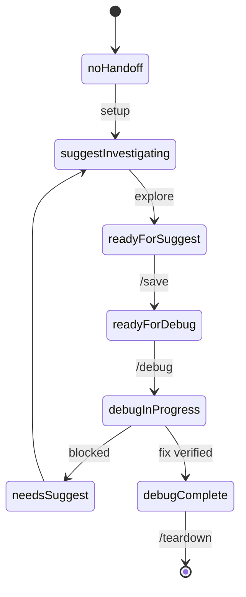
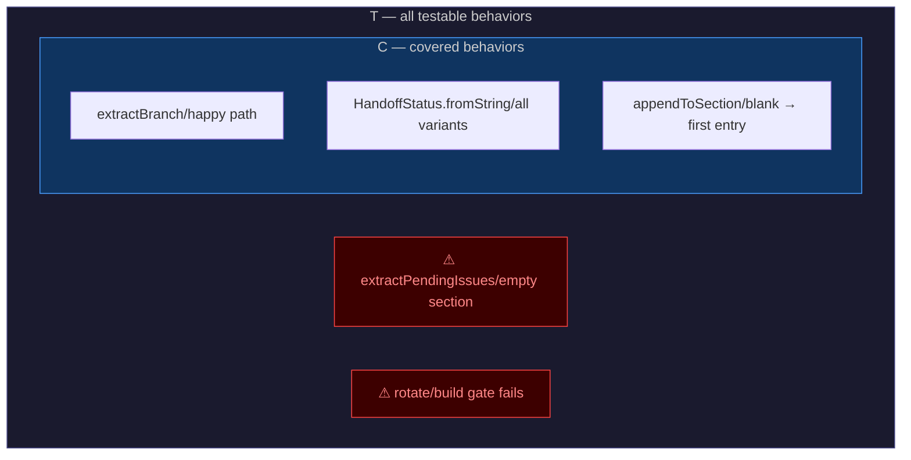
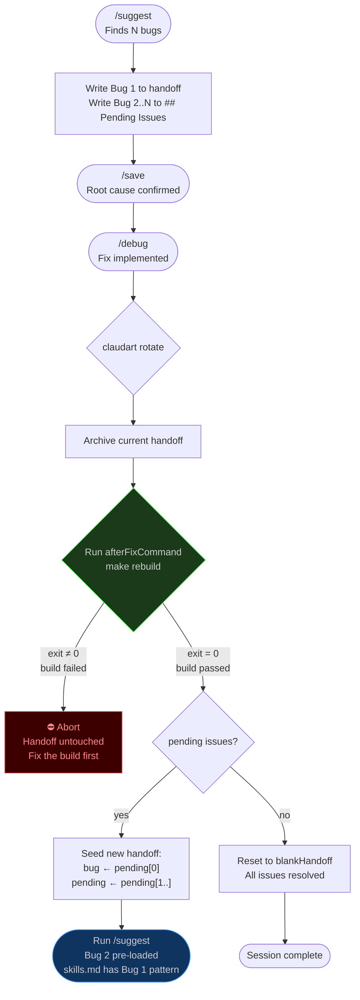

# claudart — Formal Design

> Mathematical foundations, proofs, and diagrams for the claudart session workflow.
> Read alongside `experiments/2026-03-17-reasoning-design-session.md`.

---

## 1. Session State Machine

### Formal definition

Let **S** be the finite set of session states — the `HandoffStatus` enum
(`lib/session/session_state.dart`), 8 variants total:

```
S = { no-handoff, suggest-investigating, ready-for-suggest, ready-for-debug,
      debug-in-progress, debug-complete, needs-suggest, unknown }
```

`no-handoff` and `unknown` are sentinel values — never written to
handoff.md (see `HandoffStatus.value`'s doc comment). `no-handoff` is the
pre-session state (zedup-local, emitted when no handoff exists yet);
`unknown` is the parse-failure fallback for an unrecognized status string.
Neither participates in the transition table below; the automaton's real
work happens across the remaining 6 persisted states.

Let **C** be the finite set of commands:

```
C = { claudart setup, /suggest, /save, /debug, claudart rotate,
      claudart teardown, claudart kill }
```

The session is a **deterministic finite automaton** `(S, C, δ, s₀, F)` where:

- `s₀ = no-handoff` (initial state, before `claudart setup` writes a handoff)
- `F = { resolved }` (accepting / terminal state reached by teardown; not an
  `HandoffStatus` value itself — `debug-complete` transitions here via
  `/teardown`, at which point the handoff is archived and reset)
- `δ : S × E → S ∪ {rejected}` is the transition function, partial by design: a move the table does not list is
  rejected (`HandoffStatus.after` returns `null`)

**Transition function δ:**

| Current state | Command | Next state | Precondition |
|---|---|---|---|
| `no-handoff` | `claudart setup` | `suggest-investigating` | — |
| `suggest-investigating` | `/save` | `suggest-investigating` | root cause unconfirmed |
| `suggest-investigating` | `/save` | `ready-for-suggest` | root cause confirmed, further exploration expected |
| `suggest-investigating` | `/save` | `ready-for-debug` | root cause confirmed, ready to implement |
| `suggest-investigating` | `claudart rotate` | `suggest-investigating` (new session) | build gate passes |
| `ready-for-suggest` | `/save` | `ready-for-debug` | — |
| `ready-for-debug` | `/debug` | `debug-in-progress` | — |
| `ready-for-debug` | `claudart rotate` | `suggest-investigating` (new session) | build gate passes |
| `debug-in-progress` | `/save` | `debug-in-progress` | — |
| `debug-in-progress` | (blocked) | `needs-suggest` | debug hits a question suggest must resolve |
| `needs-suggest` | `/suggest` | `suggest-investigating` | — |
| `debug-in-progress` | fix verified | `debug-complete` | — |
| `debug-in-progress` | `claudart rotate` | `suggest-investigating` (new session) | build gate passes |
| `debug-complete` | `claudart teardown` | `resolved` (archived) | — |
| any | `claudart kill` | `∅` (handoff erased) | — |

**Key property:** `δ` is a real function in code: `HandoffStatus.after(HandoffEvent)` in
`lib/session/session_state.dart`, returning the next status or `null` when the table has no such move
(the move is rejected). It is *not* compiler-exhaustive — `after` switches over an `(event, status)` pair
with a `null` default — so completeness is proven by `test/session/handoff_transition_test.dart`, which checks every
`(status, event)` pair against an independent literal copy of this table, and checks that every persisted status is
reachable from `no-handoff` and has an exit.

**Consumer view.** A reset leaves the blank handoff on disk, whose Status line still reads
`suggest-investigating`. The status a consumer should show is `SessionState.effectiveStatus`: `no-handoff` when the
handoff has no active content, the parsed status otherwise. `test/conformance/lifecycle_test.dart` pins it step by step
across whole lifecycles, and `make consumer-check` replays the same scenarios against zedup's real reader.

**Events** (`lib/session/handoff_event.dart`) name outcomes, one per row above: `setup`, `saveUnconfirmed`,
`saveConfirmedExploring`, `saveConfirmedReady`, `debugStarted`, `debugBlocked`, `suggestResumed`, `fixApplied`, `rotated`,
`rotatedEmpty`, `tornDown`, `reminderSaved`, `killed`. `rotatedEmpty`, `tornDown`, `reminderSaved` and `killed` land in `no-handoff` (the handoff is reset or erased).

**Deliberate extensions to the table** (what the commands actually do today; each is a row in the code and its test):

| Current state | Event | Next state | Why |
|---|---|---|---|
| `ready-for-debug`, `debug-in-progress`, `needs-suggest` | `saveConfirmedReady` | `ready-for-debug` | `/suggest` re-run overwrites an existing handoff after the user confirms |
| `ready-for-debug`, `debug-in-progress` | `fixApplied` | `debug-complete` | `/debug` applies its plan and marks it complete in one step; claudart does not verify the fix, so "fix verified" is named for what happens |
| `suggest-investigating`, `ready-for-debug`, `debug-in-progress` | `rotatedEmpty` | `no-handoff` | `claudart rotate` with no pending issue archives the session and resets the handoff to blank |
| any persisted state | `reminderSaved` | `no-handoff` | `claudart teardown` on an unresolved session saves a reminder and resets the handoff |
| any persisted state | `killed` | `no-handoff` | `claudart kill` erases the handoff |

### State diagram



A simplified view for reading. The complete, generated diagram (every move
`HandoffStatus.after` allows) is in docs/topology/handoff_status.md and README.md;
`unknown` (parse-failure sentinel) and the `claudart kill`/`claudart
rotate` edges (available from any state, omitted here to keep the
diagram legible) are the two things this simplified view leaves out of
the full transition table above.

---

## 2. Coverage Model

### Definitions

```
T  =  set of all testable behaviors in the codebase
      (public functions + enum contracts + parse rules + branches)

C  =  set of behaviors with at least one assertion

Gap  =  T − C  (set difference)
```

**Theorem:** A session is complete if and only if `Gap = ∅`.

**Corollary:** Every operation that adds an element to `T` requires a test before the session closes.

### What adds to T

| Operation | Element added to T |
|---|---|
| New public function `f` | `{f}` |
| New enum variant `v` on enum `E` | `{(E, v, g) : g ∈ getters(E)}` |
| New getter `g` on enum `E` | `{(E, v, g) : v ∈ variants(E)}` |
| New regex or parse rule | one element per distinct input class |
| New branch in existing function | one element per new path |
| New record field | one element per constructor call site |

### Subset relationship

```
C ⊆ T     always (you cannot cover a behavior that doesn't exist)
C = T     session complete
C ⊂ T     gap exists — session not done
```

### Coverage diagram



> When `g1` and `g2` exist, `Gap ≠ ∅` and the session is not complete.
> Both are now covered — see `test/session/teardown_utils_test.dart` and `test/commands/rotate_test.dart`.

---

## 3. Enum Test Matrix

### Definition

For an enum **E** with:
- Variants: `V = {v₁, v₂, ..., vₙ}`
- Getters: `G = {g₁, g₂, ..., gₘ}`

The **required test matrix** is the Cartesian product:

```
M(E)  =  V × G  =  { (vᵢ, gⱼ) : 1 ≤ i ≤ n, 1 ≤ j ≤ m }

|M(E)|  =  |V| × |G|    (required assertions)
```

**Proof that every cell is necessary:**

For any `(vᵢ, gⱼ) ∈ M(E)`, the assertion `expect(vᵢ.gⱼ, expectedValue)` is the only statement that can detect a regression in the mapping `gⱼ(vᵢ)`. No other test covers this cell because:
1. The getter `gⱼ` is a `switch` expression — each arm is independently reachable
2. A bug in arm `vᵢ` does not affect any other arm
3. Therefore each cell is an independent failure mode

### TeardownCategory matrix (concrete example)

`TeardownCategory` has 8 variants and 3 getters → `|M| = 8 × 3 = 24` required assertions.

| variant | `.value` | `.area` | `.label` |
|---|---|---|---|
| `apiIntegration` | `'api-integration'` | `'api'` | `'api-integration'` |
| `concurrency` | `'concurrency'` | `'async'` | `'concurrency'` |
| `configuration` | `'configuration'` | `'config'` | `'configuration'` |
| `dataParsing` | `'data-parsing'` | `'data'` | `'data-parsing'` |
| `ioFilesystem` | `'io-filesystem'` | `'io'` | `'io-filesystem'` |
| `stateManagement` | `'state-management'` | `'state'` | `'state-management'` |
| `general` | `'general'` | `'fix'` | `'general'` |
| `other` | `'other'` | `'fix'` | `'other (type manually)'` ← distinct |

All 24 cells are asserted in `test/session/teardown_utils_test.dart`.

**Matrix growth rule:**
- New variant added → new row → `m` new assertions required
- New getter added → new column → `n` new assertions required
- Both → `n + m + 1` new assertions required

---

## 4. Rotate — Formal Process Specification

### Pre/post conditions

```
Pre(rotate):
  handoff ≠ blankHandoff          -- active session exists
  user confirms                   -- explicit consent
  afterFixCommand ∈ config        -- build command is configured

Invariant (build gate):
  ∀ rotate call: afterFixCommand exits 0 before new handoff is written

Post(rotate) when pending ≠ ∅:
  archive ∈ archiveDir            -- old session preserved
  handoff.bug = pending[0]        -- first pending issue seeded
  handoff.pendingIssues = pending[1..]  -- queue advanced by one
  handoff.status = suggest-investigating  -- clean state for /suggest

Post(rotate) when pending = ∅:
  archive ∈ archiveDir            -- old session preserved
  handoff = blankHandoff          -- all issues resolved
```

### The build gate as an invariant proof

**Claim:** No session `n+1` can begin unless session `n`'s fix compiles.

**Proof:**
1. `rotate` archives the current handoff (write to archive/)
2. `rotate` calls `afterFixCommand` and awaits exit code
3. If `exitCode ≠ 0` → return `RotateResult.buildFailed`, handoff is NOT overwritten
4. If `exitCode = 0` → seed new handoff
5. Therefore: the only path to a new handoff is through a passing build ∎

**Why this matters:** The tool being self-hosted means the compiled binary at `~/bin/claudart` is what runs the next session. If the fix broke the build, the next session would run stale code. The gate makes this impossible.

### Rotate flow diagram



---

## 5. Type Selection as a Decision Function

### Formal model

Let **need(X)** be the set of required operations on a collection X.
The type selection function `τ` maps `need(X)` to the optimal Dart type:

```
τ(need) = argmin_type { cost(type, need) }

where cost(type, need) = Σ complexity(op) for op ∈ need
```

### Decision table (the τ function instantiated)

| need(X) | τ(need) | dominant cost |
|---|---|---|
| lookup only, no order | `HashMap<K,V>` | O(1) amortized |
| lookup + insertion order | `LinkedHashMap<K,V>` (default `{}`) | O(1) amortized |
| lookup + sorted iteration | `SplayTreeMap<K,V>` | O(log n) |
| membership + uniqueness | `HashSet<T>` | O(1) amortized |
| membership + sorted | `SplayTreeSet<T>` | O(log n) |
| ordered + indexed | `List<T>` | O(1) index, O(n) search |
| immutable lookup table | `const Set<T>` | O(1), compile-time |
| named tuple, no behavior | `({T a, U b})` record | stack-allocated |
| fixed variants + owned values | `enum E { ...; T get v }` | compile-time |

**Key theorem:** A value in a `switch` or `Map` key with a fixed domain is **never** optimally represented as a `String`. The optimal type is always `enum` because:
- `String` membership: O(n) character comparison
- `enum` identity: O(1) integer comparison
- `String` exhaustiveness: unverified at compile time
- `enum` exhaustiveness: compiler-enforced (missing case = error)

---

## 6. No Bare Strings — Security Property

### Threat model

claudart is a self-hosted tool. The model reading and optimizing its own source code is an agent with write access. An injection attack is:

```
Attacker: the model's own training distribution
Vector:   bare String literals in command dispatch
Effect:   model substitutes a string matching its own command vocabulary
          rather than the tool's intended command
```

### Formal property

Let `Σ` be the set of all string literals in the codebase.
Let `E` be the set of values owned by enums.
Let `D ⊆ Σ` be the set of "dangerous" strings (values that should be enum-owned).

**Desired property:** `D = ∅`

**Current enforcement:**
- `analysis_options.yaml`: `missing_enum_constant_in_switch: error` — any `switch` on an enum that lacks a case is a compile error
- `prefer_const_declarations: true` — pushes values toward compile-time constants
- `avoid_dynamic_calls: true` — prevents runtime dispatch on untyped values

**Gap:** Dart's built-in lints cannot statically detect `D ≠ ∅` (a string literal that should be an enum value). This requires a `custom_lint` rule. Filed as future work in `analysis_options.yaml`.

**Current risk:** `D` is empirically small — all command names, status values, category labels, and scan scopes are enum-owned. Remaining string literals are user-facing display text, which is not a dispatch surface.

---

## 7. HandoffState — Parse-Once Proof

### Current state (multiple parse calls)

Let `h` be a handoff string of length `n`.
Let `R` be the set of regex patterns applied to `h`.

In the current implementation, each call site independently calls:
```
extractBranch(h)         -- regex on h, O(n)
extractSection(h, 'Bug') -- regex on h, O(n)
extractSection(h, 'Root Cause') -- regex on h, O(n)
...
```

Total cost per command invocation: `O(n × |R|)` where `|R| ≥ 6`.

### Target state (parse-once record)

```dart
typedef HandoffState = ({
  String branch,         // extracted once
  String bug,           // extracted once
  String rootCause,     // extracted once
  HandoffStatus status, // extracted once
});

// O(n × |R|) — paid once at command entry point
final state = parseHandoff(handoff);

// O(1) — field access, no regex
print(state.branch);
print(state.bug);
```

Total cost per command invocation: `O(n × |R|)` paid **once**, then `O(1)` per access.

**Proof of correctness:** Since `h` is immutable within a command invocation (no other process writes to `handoff.md` during execution — claudart is single-threaded), `parseHandoff(h)` is a pure function. The result is referentially transparent: `parseHandoff(h).branch = extractBranch(h)` always. Parsing once is therefore equivalent to parsing many times. ∎

**Implementation status:** Planned as Todo #1. `SessionState` class is the current partial implementation — used in `save.dart` and `rotate.dart` but not yet in `teardown.dart` or `setup.dart`.

---

## 8. WorkspaceConfig — Enum Invariants

### Context window separation

Let **K** be the set of all knowledge files in a workspace. Define two partitions:

```
K_scaffold  =  files compiled into scaffold.md by Agent 1 (/setup)
K_session   =  files loaded per session by Agent 2 (/suggest, /debug)

K_scaffold ∩ K_session = ∅     ← enforced by agent role separation
K_scaffold ∪ K_session ⊆ K
```

**Proof:** Agent 2 reads `scaffold.md` — a single compiled file, not the originals. ∀ f ∈ K_scaffold: Agent 2 never opens f directly. The intersection is empty by construction. ∎

### WorkspaceRole — README update gate

```
∀ workspace w: (w.project.role == WorkspaceRole.maintainer) ↔ (w.canUpdateReadme == true)
```

Enforced by `WorkspaceRole.canUpdateReadme` getter — a `switch` with no default. Adding a new role variant without handling it in `canUpdateReadme` is a compile error.

### StackType — knowledge scope gate

```
∀ f ∈ K_scaffold: ∃ s ∈ workspace.project.stack such that f is relevant to s
```

Enforced at `/setup`: only files listed in `workspace.session.knowledge` are compiled into `scaffold.md`. Files outside that list are never loaded regardless of what exists on disk.

### Enum parse invariant

```
∀ v ∈ workspace.json string values:
  (v ∈ EnumType.validValues) → parsed into typed enum
  (v ∉ EnumType.validValues) → dropped, reported as warning by /setup
```

`fromString` never throws — unknown values return `null` and are excluded from the parsed list. `/setup` reports them so the user can fix `workspace.json`.

### AgentType install invariant

`AgentType.commandTemplate(workspace)` uses an exhaustive `switch` over all variants:

```
∀ v ∈ AgentType.values →
  v.fileName == '${v.name}.md'  ∧  v.commandTemplate(w).isNotEmpty
```

Dart enforcement: the `switch` has no `default` arm — adding a new `AgentType` variant without a corresponding template arm is a compile error (`missing_enum_constant_in_switch: error`). `claudart link` iterates `AgentType.values`; the install loop is closed under the enum.

| Member | Invariant |
|---|---|
| `fileName` | `∀ v → v.fileName == '${v.name}.md'` — bijection between variant and filename |
| `commandTemplate` | Exhaustive switch — `∄ v` with a missing arm at compile time |
| install loop | `∀ v ∈ AgentType.values → fileIO.write(cmdsDir/v.fileName, v.commandTemplate(w))` |

This is I₆ in the invariant table below.

---

### Proof notation enforcement

`ProofNotation.dartGrounded` requires:
- `∀` / `∃` / `∧` / `∨` / `↔` as logical quantifiers in proofs
- Both sides of `↔` must be Dart expressions (not prose)
- `iff` is never used — `↔` with Dart expressions is the replacement
- Every proof cites the Dart mechanism: `const` constructor, null-safety, exhaustive `switch`, `assert()`

---

## 9. Environments and Surfaces

Section 1 describes one session. This section describes every place a session runs: how it is started, how the
project is linked to its workspace, whether the project uses dartrix. Each layer is a typed enum or a getter on one,
checked against the code, so a gap shows up as a failing test or a "no caller yet" row instead of a surprise.

The generated reference is `docs/topology/environments.md` (and `docs/topology/handoff_status.md` for the state
machine); `make topology` rewrites them and a test fails when they go stale.

### 9.1 Layers

| Layer | Typed as | Variants | Verified by |
|---|---|---|---|
| Entry point | `CommandEntry` + `ClaudartCommand.reachedFrom` | `cliSubcommand`, `launcherMenu` (`claudart` with no args), `chatShell` | `claudart_command_test.dart` scans `launch.dart` and `chat_shell.dart` for each call |
| Run mode | `RunMode` + `ClaudartCommand.supportsHeadless` | `interactive`, `headless` (`teardown`, `rotate`, `kill`) | the same test scans each command's source for a `RunMode` parameter |
| Render surface | `ClaudartSurface` | `cli`, `tui` (zedup) | `make consumer-check` (below) |
| Handoff moves | `ClaudartCommand.handoffEvents` | the `HandoffEvent` each command passes | the same test scans `lib/` for each event |
| Workspace awareness | `WorkspaceSummary` + `claudart workspaces [--json]` | every linked workspace: status, link state, lock, current | `workspaces_test.dart`, `workspaces_cli_test.dart` (real binary) |
| Workspace targeting | `--project <name>` + `ClaudartCommand.supportsProjectSelector` + `selectProject` | the 13 commands that act on a registered project's session | `project_selector_test.dart`, `workspaces_cli_test.dart`; a selectable command must take a project override |
| Link state | `WorkspaceLinkState` + `linkStateOf` | `unlinked`, `symlinked`, `realDirectory` | `workspace_link_state_test.dart`; `launch` and `kill` read it |
| dartrix | the project's pubspec (`detectsDartrixDependency`) | uses, does not use | the lifecycle matrix (below) |
| Consumer | `SessionState.effectiveStatus` | what a reader shows for a handoff | the lifecycle matrix and `make consumer-check` |

claudart is usable on its own: a CLI-only user needs none of zedup. zedup is an optional front end that reads the same
`handoff.md` and calls the same exported API; it must agree with claudart on every status it shows.

### 9.2 What is proven, and where

- **Lifecycle matrix** (`test/conformance`): real commands, in memory, through whole sessions (setup, suggest, debug,
  teardown, kill, rotate, restart), in every environment (3 link states x dartrix on or off = 6). After every step the
  consumer view (`effectiveStatus`), the file and the logged move must agree with an independent literal. The result is
  the same in every environment, which is itself the claim: the lifecycle does not depend on how the project is linked or
  whether it uses dartrix.
- **Consumer check** (`make consumer-check`): replays the same scenarios against zedup's REAL reader in a throwaway copy
  of zedup wired to this checkout (neither repo is modified), and scans zedup for raw-string status writers.

### 9.3 Known gaps (each is a failing check or a visible row, not folklore)

| Gap | Where it shows | Owner |
|---|---|---|
| zedup reads the raw Status line, so a reset session shows as a live one | `make consumer-check`: 4 reader disagreements | zedup: read `SessionState.effectiveStatus` in `parseClaudartHandoff` |
| zedup's TUI writes status as raw strings (`updateStatus`), bypassing validation and `transitions.jsonl` | `make consumer-check`: 2 raw writers (`suggest_coordinator.dart`, `debug_coordinator.dart`); `updateStatus` is now deprecated | zedup: use `applyHandoffEvent` |
| dartrix has no behavioural effect on a session: only `claudart add`'s PLAN stub reads it, and the generated `dependency_config.g.dart` constant has no reader | `environments.md` "dartrix" section | decide: gate something on it, or drop the constant |
| `claudart link` and `unlink` are not in the lifecycle matrix: the link state is a fixture, not an outcome of running them | `lifecycle_scenarios.dart` | add link/unlink scenarios |
| the agent surface (a Claude Code or Cursor slash command running claudart) is not modelled | none yet | add a `CommandEntry` for it once its calls are enumerated |
| 4 handoff events have no code caller (`saveUnconfirmed`, `saveConfirmedExploring`, `debugStarted`, `debugBlocked`): agents make those moves by editing `handoff.md` as the prompts say | `handoff_status.md` "Where each event is passed" | by design today; revisit if claudart should verify them |

### 9.4 Ownership: how the three repos split

Every public component has one owning repo. The owner declares it and tests it (a literal table per variant,
mutation-tested). A consumer tests only its own extensions and its integration with the owner, never the owner's
behavior again. `make ownership` snapshots this into `docs/topology/ownership.md`: components per repo, names declared
in more than one repo, and tests that assert another repo's component behavior.

| Repo | Owns | Consumers must not re-test |
|---|---|---|
| claudart | the session state machine (`HandoffStatus`, `HandoffEvent`, `after`, `effectiveStatus`), the error taxonomy, the model registry (`AgentModel`, `AgentFlow.preferredModel`), `ClaudartCommand` and its entry/headless/event declarations, link state, codegen | any of the above |
| dartrix | the matrix and coverage framework (`Dartrix`, `testSelector`, the shoelace snapshot types) and the paradigm law | its own matrix mechanics |
| zedup | the TUI: its own screens, hotkeys, tool manifests, `kZedupConfig`, its extensions on claudart types (e.g. `AgentFlow.label`) | claudart's types' behavior |

Findings from the first scan, each a tracked gap rather than folklore:

- **Duplicated components:** `ErrorType`, `FailureType`, `FaultClass` and `FaultSeverity` are declared in both claudart
  and zedup (zedup has its own copy of the error taxonomy). One owner: claudart; zedup consumes it (Phase 1 step 8).
- **Misplaced tests, now fixed:** `AgentModel` (alias, slug, shortName, `bestFor*`) and `AgentFlow.preferredModel` were
  tested only in zedup's `claudart_model_test.dart`: the owner did not test its own components. They are now pinned in
  `test/pipeline/agent_model_test.dart` and `agent_flow_test.dart`.
- **Redundant tests, to remove from zedup:** `agent_result_test.dart` asserts `HandoffStatus.expectsDebug`,
  `expectsSuggest` and `fromString` (claudart pins all three per variant); `agent_dispatcher_test.dart` and
  `claudart_model_test.dart` assert `AgentModel.alias` and the `bestFor*` predicates (now pinned here).
- **dartrix knows zedup's variants:** its shoelace test fixtures hard-code zedup's `BranchType` names as strings. The
  framework should stay generic; the fixture should use its own fictional enum.

### 9.5 Environment configuration drives what a user sees

The user's environment (which tools they use, how the project is linked, which agents and stack they chose) should
decide which enums and templates they are exposed to, so they only interface with code that applies to them.

| Where it already works | How |
|---|---|
| zedup | `zedup setup` answers + each tool's manifest generate `kZedupConfig`; the UI exposes only opted-in tools' commands, hotkeys and screens |
| claudart slash commands | `claudart link` writes a command file for each `AgentFlow` with `hasCommandFile`, so the commands a user sees are driven by an enum |

| Where it does not yet | Evidence |
|---|---|
| workspace.json's `session.agents`, `knowledge` and `stack` | written by `claudart link`; read only by the `/setup` agent prompt (an agent following instructions), never by Dart code: the command files `link` generates come from `AgentFlow.values`, not the user's `session.agents` |
| the generated `dependency_config.g.dart` (`usesDartrix`) | no reader; dartrix changes nothing a user sees except `claudart add`'s PLAN stub |

Direction, in dependency order: (1) make workspace.json's selection the input to `claudart link`'s generated command files;
(2) run the lifecycle matrix and `make consumer-check` in each configuration so the exposed surface is proven, not assumed.
An earlier draft here proposed a generated per-environment registry; PLAN.md Phase 15 supersedes it with measurements
(a facade filters only top-level names, enum variants leak through it, and a dead component costs about 0.7 ms at startup),
so the scoping is done by filtered rendering of the user-facing surfaces, not by per-environment API facades.

### 9.7 Workspace scoping (verified)

A session belongs to one workspace, and one claudart installation serves many. Two questions are separate: is each
session scoped to its own workspace, and can an agent learn about and reach the others.

**What scopes a session today.** Each project's `.claude` is linked to its own workspace's `.claude/commands`, and every
generated slash-command file is named `<flow>-<project>.md`. A flow finds its workspace in one of two ways:

| Flow | How it finds its workspace | Its claudart CLI calls |
|---|---|---|
| suggest, debug, save, teardown | the workspace path is baked into the file | now pass `--project <name>` |
| setup, flow | at run time: `claudart status` for the current directory | n/a |

**Proved, not assumed** (`test/conformance/workspace_scope_test.dart`, two linked projects in one registry):
- each workspace's generated commands name only their own workspace path and never the other's;
- every command in every lifecycle step, in both directions, leaves the other workspace's files and its registry entry
  byte-identical (injecting a registry bug that touches every entry fails 4 cases, naming the step);
- a command run from a directory that is not a linked project exits 1 and writes nothing.

**Gaps found while verifying, and what closed them:**
- Inside the four baked-path flows the file reads used the baked workspace while the CLI calls used the current
  directory, so an agent whose directory had moved would read one workspace and checkpoint another. Those flows now pass
  `--project <name>`, so both resolve to the same workspace.
- No agent-visible way to learn that other workspaces exist. `claudart workspaces [--json]` lists them (status via
  `effectiveStatus`, link state, lock, which is current), and every command template now carries a scope note
  (`workspaceScopeNote`) saying how to list them, never to edit another handoff by hand, and to use `--project`.
- `--project` first lost live-branch detection for the selected project (a project override skipped git detection, so
  `claudart --project other setup` prompted for the branch and swallowed the first answer). Found by running the real
  binary; `detectGitContext` now takes a working directory and 8 call sites use it.
- The central error handler logged to the current directory's workspace even under `--project`; it now logs to the
  selected one (a hand-mutation of that line is caught).

**Logged, so the behaviour can be checked from the files:** `--project` appends
`{command, outcome: targeted-by-project}` to the *targeted* workspace's `logs/interactions.jsonl`; `claudart workspaces`
appends `{command: workspaces, outcome: listed N workspaces}` to the *asking* workspace's. An unknown name writes nothing
(no workspace to write to). Each is asserted against the real binary, including that no other workspace's log changes.

**Open:**
- An agent can start a session in another workspace only partly. `claudart --project <name> setup` works with its
  answers on stdin (tested), and `rotate`, `teardown` and `kill` take `--headless`; the model-driven `suggest` and `debug`
  are best run in that workspace's own agent session, which `claudart workspaces` points to.
- Existing workspaces keep their old command files until `claudart link` is re-run (`doctor` reports them stale).
- zedup should call `summarizeWorkspaces` and `selectProject` (now exported) instead of parsing `registry.json` itself.

### 9.9 Binding Claude Code to the session

A prompt can ask an agent to follow the flow; a hook enforces it at the edit. `ClaudartArtifact.claudeSettings` (written by
`claudart link`, checked by `doctor` through `artifact_state`) merges a `PreToolUse` hook on `Edit|Write|MultiEdit` and
`CLAUDART_DEBUG=1` into the project's `.claude/settings.json`, keeping the rest of the file. The hook is `claudart hook
pre-edit` (`lib/commands/hook.dart`): it matches the edited path to a linked project (no `git` process; the deepest
project root wins), reads `SessionState.effectiveStatus`, and decides from three facts: Dart source or not,
`canStartDebug` or not, and `owner.strict`. Silent when it is not Dart, the session can implement, or no project matches;
otherwise advise (add context Claude sees) or, when strict, deny. `owner.strict` already meant "agents enforce strict
architectural integrity"; it now also gates edits outside a ready session. A hook that fails exits 0, so it can never
block work by accident. Proof: `hook_test.dart` pins every status x strict x Dart-or-not cell against an independent
literal; `claude_settings_template_test.dart` and `artifact_state_test.dart` pin merge, idempotence, user content kept
and the fresh/stale/missing states. Gap: a build of claudart on `PATH` without `hook` makes every edit show a non-blocking
hook error until `claudart compile` is run.

Sensitivity and the trace (the review's C5). The trace writes full prompts to disk, so it must not run for a sensitive
project. Sensitivity is stored in `registry.json` and in `workspace.json`, and the two can disagree; `link` reconciles
them once (`reconcileSensitivity`, never weakening) and records the result on the `RegistryEntry`, which is the one place
anything asks (`permitsDebugTrace`). The settings artifact adds `CLAUDART_DEBUG` only where the entry permits it and
removes the `1` it set otherwise; the binary ignores an ambient `CLAUDART_DEBUG` for a project that does not permit it,
while an explicit `--debug` still works.

### 9.8 Layering (audited, open)

Dependencies are meant to run downward, with `lib/commands/` on top. Audited against the imports:

- **Holds:** nothing outside `lib/commands/` imports it, and `lib/session/` does not import `commands`.
- **Not one-way, no file-level cycle:** `pipeline` and `templates` import each other (`agent_flow.dart` imports the
  templates; `flow`, `save`, `suggest` and `teardown` templates import `pipeline/agents/*`); `pipeline` and `ui` import
  each other; `session` and `templates` import each other (`session_ops.dart` imports `handoff_template`).
- **Lower layers reaching up into `pipeline`:** `logging/planner_log.dart`, `workspace/workspace_config.dart`, and
  `md_io.dart` (which also imports `ui`, so `session` reaches `ui` through `skills_lookup`).
- **Not yet enforced.** PARADIGMS.md keeps a lint for dependency direction as prose-only until a workspace names its
  layering. Fixing these means moving shared types (the agent categories the templates read, the render helpers
  `pipeline` calls) down into a leaf directory; that is a restructure, to be done as its own change with its own tests.

### 9.6 Data layer and model metadata (see PLAN.md, Phase 14)

Session and configuration state is persisted in a handful of files, each with one typed owner (handoff: `SessionState`;
registry: `Registry`; workspace: `WorkspaceConfig`; project: `ProjectConfig`; archive: `ArchiveEntry`; pending:
`PendingConfirmationStore`; logs: `SessionLogger`). Where two readers parse the same file independently the layers can
drift; the first verified instances are the handoff status (three readers), `sensitivityMode` (stored in both
`registry.json` and `workspace.json`, and they disagree today) and zedup's raw handoff writes.

Model information has three kinds: declared (the `AgentModel` registry, keyed by alias), resolved (what the machine maps
an alias to: provider env, `~/.claude/settings.json`) and observed (what the `claude` stream says actually ran). Only the
observed value is 1:1, and it belongs to a step, not a session.

**Observed model state (built).** The `claude` stream's final `result` line already carries `modelUsage[<id>]` (id,
`contextWindow`, `maxOutputTokens`, per-model tokens and cost; captured from a real run), so reading it adds no model
call and no prompt tokens. `parseClaudeResultLine` puts it on `StepResult.models`; the completion event carries it with
the intended model; `reconcileModel` compares it with the declared `AgentModel` (`slug` via `fromSlug`, `contextWindow`,
`maxOutputTokens`); `SessionLogger.logStepModels` appends one line per step and model to `logs/models.jsonl`; `claudart
status` shows the newest per step. The declared fields are kept because each is read here. The proof is generated:
`docs/topology/model_metadata.md`, with tests that fail on a declared fact nothing reads, on a model id spelled outside
`agent_model.dart`, and on a run that adds a call or changes a prompt. The repository layer over the rest of the state
is PLAN.md Phase 14.

## 10. Source of truth and generation (see PLAN.md, Phase 15)

The Dart enums are the source of truth, not a YAML mirror of them. Each repo publishes its public enums with metadata as
getters (the shape `ClaudartCommand` and `AgentFlow` already have); other repos consume them as ordinary pub API, so a change
reaches them as exhaustive-switch compile errors. Generation exists only for user-facing surfaces (slash-command files,
help, hotkeys, menus): enum values filtered by a typed selection, rendered inside `claudart link` / `zedup setup`, with a
render-and-diff drift test per generated file. No per-environment facades, no build_runner, no conditional imports.

Non-redundancy is checked, not asserted: `make ownership` (duplicate components), a derived-not-copied test per declaration,
a drift test per generated file, one writer per generated file, and every generated symbol has a reader.

## Summary: The Three Invariants

These are the core invariants claudart enforces. They are not conventions — they are compile-time or runtime proofs.

| # | Invariant | Enforcement | Proof |
|---|---|---|---|
| I₁ | Every state transition is exhaustive | `missing_enum_constant_in_switch: error` | Compiler rejects missing arms |
| I₂ | Every testable behavior has an assertion before session closes | `dart test --test-randomize-ordering-seed=random` + coverage model | `Gap = T − C = ∅` |
| I₃ | No session n+1 begins unless session n's fix compiles | `rotate` build gate | `exitCode = 0` is the only path to new handoff |
| I₄ | scaffold.md and session context are disjoint | Agent role separation — Agent 2 reads `scaffold.md`, never the originals | `K_scaffold ∩ K_session = ∅` by construction |
| I₅ | README updates are gated on workspace ownership | `WorkspaceRole.canUpdateReadme` exhaustive switch | `(role == maintainer) ↔ (canUpdateReadme == true)` |
| I₆ | Every AgentType variant installs its command template | `AgentType.commandTemplate` exhaustive switch + `AgentType.values` loop in `link.dart` | `∀ v ∈ AgentType.values → v.fileName installed ∧ v.commandTemplate(w).isNotEmpty` |
