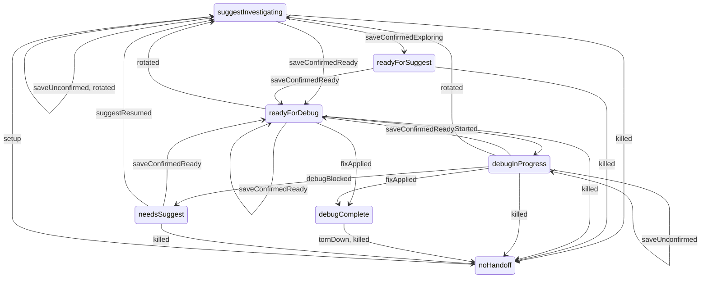

# HandoffStatus topology

> Generated by `make topology` from the code. Do not edit by hand: a test fails when this file and the code disagree.

## Moves (`HandoffStatus.after`)

## What each status answers

| variant | value | isPersisted | canStartDebug | expectsSuggest | expectsDebug |
|---|---|---|---|---|---|
| suggestInvestigating | suggest-investigating | true | false | true | false |
| readyForSuggest | ready-for-suggest | true | false | true | false |
| readyForDebug | ready-for-debug | true | true | false | true |
| debugInProgress | debug-in-progress | true | true | false | true |
| debugComplete | debug-complete | true | false | false | false |
| needsSuggest | needs-suggest | true | false | true | false |
| noHandoff | no-handoff | false | false | true | false |
| unknown | unknown | false | false | true | false |

## Where each event is passed

Files in `lib/` that mention the event, other than the table itself. "— no caller yet" is wiring still to do.

| event | passed by |
|---|---|
| setup | — no caller yet |
| saveUnconfirmed | — no caller yet |
| saveConfirmedExploring | — no caller yet |
| saveConfirmedReady | lib/commands/suggest.dart |
| debugStarted | — no caller yet |
| debugBlocked | — no caller yet |
| suggestResumed | — no caller yet |
| fixApplied | lib/commands/debug.dart |
| rotated | — no caller yet |
| tornDown | — no caller yet |
| killed | — no caller yet |

## Where it is logged

Every applied move is appended to `<workspace>/logs/transitions.jsonl` as `{ts, command, from, event, to}` (enum names). A rejected move throws `InvalidHandoffTransitionException` and is logged by the central error handler.
